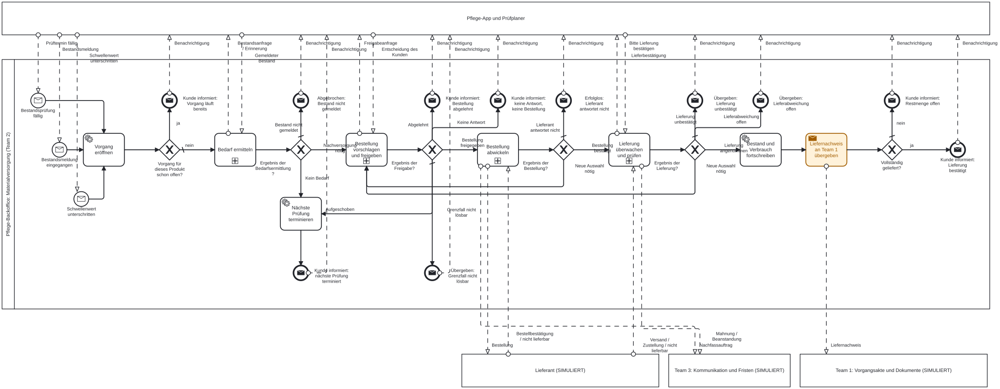
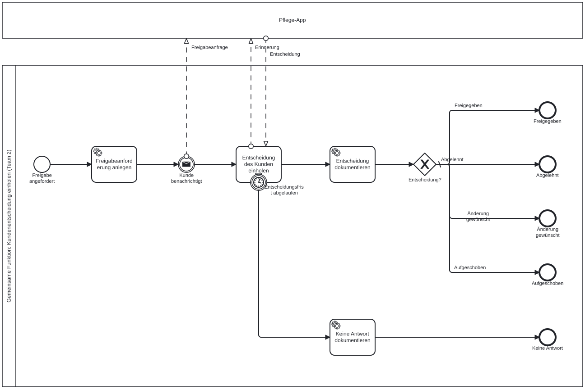

# Team 2 – Materialversorgung (Version 3, Montag-Stand)

Ausführbares Prozessmodell für Teamauftrag 2 „Ausgewählte Verbrauchsprodukte rechtzeitig und kontrolliert nachversorgen“, für **Camunda 7 / CIB seven** (Modeler 5.52, Camunda 7.24).

**Stand 7. November 2026, Entwurf.** Diese Version setzt Amars Review (`Teamprojekt_T2_Materialversorgung/Doku`) um. Sie ist noch **nicht auf CIB seven getestet** und noch **nicht vom Team bestätigt**. Version 2 liegt unverändert in `Teamprojekt_T2_Materialversorgung/`.

Entstehung: Der Entwurf wurde mit KI-Unterstützung (Claude) erstellt. Das Team prüft ihn und verantwortet das Ergebnis.

## Diagramme

GitHub zeigt `.bpmn`-Dateien nur als XML. Zum Bearbeiten die Datei im Camunda Modeler öffnen. Teilprozesse öffnet man dort mit dem **+** unten am Kasten.

**Oberste Ebene** (`T2_Materialversorgung.bpmn`): 9 Aktivitäten, davon 4 Teilprozesse

[](bilder/0_Oberste_Ebene.svg)

| Teilprozess | Teamauftrag Schritte | Endzustände (= Ausgänge des folgenden Gateways) |
|---|---|---|
| [1 Bedarf ermitteln](bilder/1_Bedarf_ermitteln.svg) (darin [1a Bestandsmeldung einholen](bilder/1a_Bestandsmeldung_einholen.svg)) | 1–3 | Nachversorgung nötig · Kein Bedarf · Bestand nicht gemeldet |
| [2 Bestellung vorschlagen und freigeben](bilder/2_Bestellung_vorschlagen_und_freigeben.svg) | 4–7 | Bestellung freigegeben · Aufgeschoben · Abgelehnt · Keine Antwort · Grenzfall nicht lösbar |
| [3 Bestellung abwickeln](bilder/3_Bestellung_abwickeln.svg) | 8–9 | Bestellung bestätigt · Neue Auswahl nötig · Lieferant antwortet nicht |
| [4 Lieferung überwachen und prüfen](bilder/4_Lieferung_ueberwachen_und_pruefen.svg) (darin [4a Lieferbestätigung einholen](bilder/4a_Lieferbestaetigung_einholen.svg)) | 9–10 | Lieferung angenommen · Neue Auswahl nötig · Lieferung unbestätigt · Lieferabweichung offen |
| Oberste Ebene: Bestand fortschreiben, Beleg an Team 1 | 11–12 | – |

**Gemeinsame Funktion „Kundenentscheidung einholen“** (`T2_Kundenentscheidung_einholen.bpmn`, auch für Team 1 und 3)

[](bilder/5_Kundenentscheidung_einholen.svg)

Darin: [5a Entscheidung des Kunden einholen](bilder/5a_Entscheidung_des_Kunden_einholen.svg) (Aufgabe mit Erinnerung, Frist am Teilprozess).

## Was gegenüber Version 2 geändert ist (Amars Review)

| Review-Punkt | Umsetzung in Version 3 |
|---|---|
| **A1** Nachrichten gehen beim Nachfassen verloren | Empfangsaufgabe „Auf Bestellbestätigung warten“ mit **nicht unterbrechendem** Timer fürs Nachfassen (Muster A20). Das Warten bleibt aktiv. Dazu Ränder für „Nicht lieferbar“, „Zustellung gemeldet“ und die endgültige Frist. Nach der Bestätigung meldet der Lieferant „Versand“ und kann noch „nicht lieferbar“ melden. |
| **A2** Zähler im Simulator | `anzahlNachfassen` und `anzahlAnfragen` zählt jetzt der Prozess (Take-Listener). Der Nachfass-Zyklus `R2/PT48H` begrenzt die Anzahl. |
| **A3** Aufgaben ohne Frist | Alle Aufgaben der Prüfstelle haben `fristPruefstelle`. „Lieferung prüfen“ hat eine Frist und endet in „Lieferung unbestätigt“, nie automatisch erfolgreich. |
| **A4** Zwei Vorgänge für ein Produkt | „Vorgang eröffnen“ prüft laufende Vorgänge. Ende „Kunde informiert: Vorgang läuft bereits“. |
| **B1** Rest-Token beim Abbruch | Aufgabe und Erinnerung liegen in einem Teilprozess, die Frist hängt am Teilprozess (Muster A21). |
| Stilregel 2: höchstens 10 Aktivitäten je Ebene | Oberste Ebene 9, Teilprozesse 1 bis 6 |
| Stilregeln 10–12: Label-Matching | Jeder Teilprozess hat je Ergebnis ein Endereignis. Das folgende Gateway hat genau gleich benannte Ausgänge. |
| Stilregel 19: keine XOR-Zusammenführung vor Aufgaben | keine mehr, Flüsse laufen direkt in die Aufgabe |
| Stilregeln 13–15: Nachrichtenflüsse | alle gezeichnet und beschriftet |
| Stilregel 7: Endereignisse | Erinnerungen enden in „Erinnerung versandt“ im Teilprozess, nicht mehr als scheinbarer Endzustand |
| Lanes ohne Wirkung | Rollen über `candidateGroups`: `pflegende-person`, `pruefstelle` (siehe Start) |
| Pool „Aufrufender Prozess“ | entfernt |
| Integration farbig | Sende- und Empfangsaufgaben orange (Foliensatz 07) |
| Teil- oder Falschlieferung | „Lieferabweichung klären“: Nachlieferung (warten geht weiter), Teilmenge übernehmen (Ende „Restmenge offen“) oder übergeben |
| Aufschub | eigener Ausgang, frühere Prüfung terminiert, Text nennt das Reichweitenrisiko |
| Preisgrenze je Produkt, Alternative | `betragsgrenze` im Produktprofil. Der Kunde kann bei „Ändern“ Menge, Ersatzprodukt oder Alternativlieferant wählen. |
| Enden ohne Kundeninfo | alle Endzustände der obersten Ebene benachrichtigen den Kunden |
| DMN: Quelle, Aufteilung, Ersatzpreis | Annotation „Quelle“ je Regel, Profil und Fristen getrennt, `stueckpreisErsatz` |

## Aufbau: Prozess, Regeln und Dienste getrennt

| Schicht | Inhalt | Dateien |
|---|---|---|
| Prozess | Ablauf, Wartezustände, Fristen, menschliche Aufgaben | `T2_Materialversorgung.bpmn`, `T2_Kundenentscheidung_einholen.bpmn` |
| Regeln und Werte | Produktdaten, Preisgrenze, Fristen, Berechtigungsregel, änderbar ohne Code | `T2_Produktprofil.dmn`, `T2_Fristen.dmn`, `T2_Berechtigungsregel.dmn` |
| Dienste | Berechnungen und Kontakte als External Tasks, vorerst simuliert | `simulator/` |

**Offene Technikfrage:** Laut Vorgaben WS 25/26 erwartet Prof. Stiehl Java 17, Quarkus, ActiveMQ, Camel und Esper. Bei uns laufen die Dienste noch als External Tasks mit Node-Simulator. Am Modell ändert sich beim Umstieg nur die Implementierung der Aufgaben. **Bitte am Montag bei Prof. Stiehl klären.**

## Dienste (Topics)

| Topic | Aufgabe | später von |
|---|---|---|
| `t2-vorgang-eroeffnen` | Vorgang anlegen, laufende Vorgänge prüfen | Team 1 (Vorgangsakte) |
| `t2-reichweite-berechnen`, `t2-pruefung-terminieren`, `t2-vorschlag-erstellen`, `t2-abweichungen-pruefen`, `t2-lieferabweichung-erfassen`, `t2-bestand-fortschreiben` | Fachlogik Team 2 | Team 2 |
| `t2-bestellung-uebermitteln` | Bestellung an Lieferdienst | Team 2 (Integration) |
| `t3-nachfassen`, `t3-mahnen`, `t3-gegenstelle-kontaktieren` | Kommunikation mit Gegenstelle | Team 3 |
| `t1-nachweis-uebergeben` | Liefernachweis | Team 1 |
| `t2-benachrichtigung-senden` | gemeinsame Benachrichtigung | Team 2 für alle |
| `t2-freigabe-anlegen`, `t2-freigabe-dokumentieren` | gemeinsame Freigabe | Team 2 für alle |

Nachrichten (Korrelation über den Business Key = `vorgangId`): `MV_Bestandspruefung_faellig`, `MV_Bestandsmeldung_eingegangen`, `MV_Schwellenwert_unterschritten` (Start), `MV_Bestellbestaetigung`, `MV_Nicht_lieferbar`, `MV_Versand_gemeldet`, `MV_Zustellung_gemeldet`.

## Testprodukte (Projektannahmen)

| Produkt | Packung / Ziel | Verbrauch | Preis | Grenze | Fristen |
|---|---|---|---|---|---|
| TP-M | 30 / 120 | 4 pro Tag | 0,45 € | 40 € | Tage |
| TP-HS | 100 / 300 | 10 pro Tag | 0,08 € | 40 € | Tage |
| TP-SCHNELL | wie TP-M | | | | **Minuten**, zum Vorführen |

## Starten und testen

Voraussetzung: CIB seven läuft (wie bei den Demos), Anmeldung demo / demo, Node.js 18+.

```bash
cd Teamprojekt_T2_Materialversorgung_v3
H=../BPMN_Demos_aus_Folien/dpe-demo.sh
bash $H deploy T2_Produktprofil.dmn T2_Fristen.dmn T2_Berechtigungsregel.dmn T2_Kundenentscheidung_einholen.bpmn T2_Materialversorgung.bpmn

# Rollen einmalig anlegen und demo zuordnen (Aufgaben haben candidateGroups)
for g in pflegende-person pruefstelle; do
  curl -s -u demo:demo -H 'Content-Type: application/json' -X POST http://localhost:8080/engine-rest/group/create -d "{\"id\":\"$g\",\"name\":\"$g\",\"type\":\"WORKFLOW\"}"
  curl -s -u demo:demo -X PUT http://localhost:8080/engine-rest/group/$g/members/demo
done

# zweites Terminal
cd simulator && npm start          # Lieferant antwortet per Hand
# oder: npm run start:auto         # Lieferant bestätigt nach dem ersten Nachfassen, meldet Versand und Zustellung
```

In der Tasklist einen Filter „Alle Aufgaben“ oder „Gruppenaufgaben“ nutzen.

### Testfall 1: Leitgeschichte (Teamauftrag 9)

```bash
bash $H msg MV_Bestandsmeldung_eingegangen '' '{"produktId":{"value":"TP-SCHNELL","type":"String"},"pflegehaushaltId":{"value":"PH-0001","type":"String"},"bestand":{"value":20,"type":"Long"}}'
bash $H instances T2_Materialversorgung
```

Erwartung: Reichweite 5 Tage < 10 Tage, 120 Stück für 54 € (über 40 €), also Kundenfreigabe. In der Tasklist innerhalb von 2 Minuten **Freigeben**. Nach 1 Minute wird über Team 3 nachgefasst, das Warten bleibt aktiv (Bestätigung innerhalb von 3 Minuten senden). Dann `bash $H msg MV_Bestellbestaetigung <id>` und `bash $H msg MV_Zustellung_gemeldet <id>` (entfällt mit `start:auto`). „Lieferung prüfen“: **Richtig und vollständig**. Ergebnis: `vorgangsstatus = Erfolgreich abgeschlossen`, `bestand = 140`, `anzahlNachfassen = 1`.

### Weitere Testfälle

| # | Fall | Vorgehen | Erwartung |
|---|---|---|---|
| 2 | **A1 nachstellen** | wie 1, Simulator stoppen, sobald „Nachfassen“ ansteht (Token bleibt dort), dann `MV_Bestellbestaetigung` senden | wird angenommen (v2: HTTP 400) |
| 3 | **A4 nachstellen** | Testfall 1 zweimal kurz hintereinander starten | zweite Instanz endet „Vorgang läuft bereits“ |
| 4 | Kein Bedarf | TP-M, Bestand 100 | „nächste Prüfung terminiert“ |
| 5 | Automatisch | TP-HS, Bestand 50 (24 €) | keine Kundenfreigabe |
| 6 | Nicht lieferbar | TP-HS, nach Bestellung `MV_Nicht_lieferbar` | „Neue Auswahl nötig“, Ersatzprodukt, dann Kundenfreigabe |
| 7 | Keine Antwort | TP-SCHNELL, Freigabe nicht bearbeiten | nach 2 Minuten „keine Antwort, keine Bestellung“ |
| 8 | Aufschub | bei der Freigabe „Später entscheiden“ | frühere Prüfung terminiert, Risiko im Text |
| 9 | Lieferung unbestätigt | „Lieferung prüfen“ liegen lassen | nach 4 Minuten „Übergeben: Lieferung unbestätigt“ |
| 10 | Bestand fehlt | TP-SCHNELL, `MV_Bestandspruefung_faellig` ohne Bestand, Aufgabe liegen lassen | erneute Anfrage, danach „Bestand nicht gemeldet“ |

## Prüfung

```bash
cd simulator && npm test && npm run pruefen
```

Stand 7.11.: 28 von 28 Tests, davon 13 fachliche Durchläufe durch das Modell ohne Engine (`test/durchlauf.test.js`: Leitgeschichte, A4, kein Bedarf, automatisch, nicht lieferbar, keine Antwort, Aufschub, Änderung, Teillieferung, unbestätigt, Bestand fehlt, Lieferant antwortet nicht, Grenzfall). Modellprüfung (Camunda 7, Stilregeln 2, 10–12, 13–15, 19, Konsistenz Modell/DMN/Simulator) 0 Fehler, DMN-Prüfung 0 Fehler, bpmnlint 0 Fehler. bpmnlint warnt bei „fake-join“ (mehrere Flüsse in eine Aufgabe). Das widerspricht Stiehls Regel 19, wir folgen Stiehl. **Nicht getestet auf CIB seven.**

## Offene Entscheidungen fürs Team

1. Technik: External Tasks erlaubt oder Quarkus, Camel, ActiveMQ, Esper (Stiehl fragen)
2. Teillieferung „Teilmenge übernehmen“: Ende „Restmenge offen“ (Status Übergeben) oder Restmenge automatisch nachbestellen?
3. Prüfplaner: Wer startet die nächste Prüfung (App/Team 1 oder Timer)?
4. Mit Team 1 und 3: Nachrichten- bzw. Queue-Namen, Kennungen, Fehlerantwort, gemeinsame Freigabe- und Benachrichtigungsfunktion
5. Lanes zusätzlich zu `candidateGroups`?

## Lizenz

MIT (Datei LICENSE kommt ins gemeinsame Repo aller Teams).
